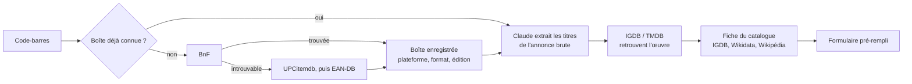

<div align="center">


# Capsule

**Vos collections dans votre poche.**

Jeux vidéo, films, livres, musique, figurines, cartes, jeux de société : une seule appli pour cataloguer
ce qu'on possède, le partager, et partir chiner les pièces qui manquent.

[**capsule.click**](https://www.capsule.click) · application web installable sur mobile (PWA)


</div>

---

## Ce que fait Capsule

### 📚 Cataloguer
- **Collections par type** : jeux vidéo, films, musique, livres, figurines, cartes à collectionner, jeux de société,
  ou mixtes. Chaque type a sa fiche : plateforme et édition d'un jeu, format d'un film (DVD, Blu-ray, 4K…),
  ISBN et éditeur d'un livre…
- **Recherche avec pré-remplissage** : on tape un titre, on choisit dans la liste, et la fiche se remplit
  (résumé, genre, date de sortie, développeur ou réalisateur, auteur, nombre de pages…).
- **Scan du code-barres** avec l'appareil photo : la boîte est reconnue, et le formulaire se remplit avec la bonne
  plateforme ou le bon format, et l'édition.
- **Ajout rapide** pour enchaîner les jeux sans ouvrir le formulaire complet.
- **Photos** de ses objets, et **statistiques** de la collection.

### 🤝 Partager
- **Collections à plusieurs**, avec un lien d'invitation et des rôles (propriétaire, membre).
- **Collections publiques** en lecture seule, à partager par lien.
- **Amis** : envoyer une note ou une brocante à un ami.

### 🧭 Chiner
- **Carnet** de notes et d'événements, avec rappels.
- **Brocantes et vide-greniers autour de chez soi**, sur une carte.
- **Raccourci vers Vinted** depuis une collection, pour trouver les pièces manquantes.

### ✨ Premium
Réservé aux comptes Premium : le **scan des jeux et des films**, l'**estimation de prix** d'un objet,
et l'**identification d'une figurine** à partir d'une photo, grâce à Claude (Anthropic).
Le scan des livres reste gratuit pour tout le monde.

---

## Le scan, de la boîte à la fiche

Un code-barres identifie **une boîte** (Zelda sur Switch, édition standard), pas **une œuvre** (Zelda).
Capsule sépare donc les deux. Chaque boîte reconnue est gardée en base : le scan suivant du même code
est immédiat et ne coûte plus aucun appel externe.



| Table | Ce qu'elle représente | Exemple |
|---|---|---|
| `products` | l'**œuvre**, partagée par tous les utilisateurs | *Catherine* (sorti sur PS3 et Xbox 360) |
| `barcode_products` | la **boîte**, une par code-barres | *Catherine*, Xbox 360, édition standard |
| `items` | l'**exemplaire** d'un utilisateur, avec sa fiche détaillée | mon *Catherine*, sur Xbox 360, en bon état |

Quelques garde-fous :
- **Mieux vaut « introuvable » qu'un mauvais jeu ajouté en silence** : tous les mots significatifs du titre cherché
  doivent figurer dans le titre trouvé.
- **Titres français** : IGDB ne cherche pas dans les titres régionaux. Capsule interroge aussi ses titres français
  officiels (« Pokémon Épée » → *Pokémon Sword*), et affiche le titre français quand il existe.
- **Repli sans IA** : si Claude ne répond pas, le titre est nettoyé par des règles, moins fiables mais suffisantes.

---

## Des sources de données utilisées dans les règles

Chaque source a ses conditions, et Capsule les respecte : certaines autorisent le stockage, d'autres seulement
l'affichage. Toutes sont citées sur la [page crédits](https://www.capsule.click/credits).

| Source | Utilisée pour | Ce qui est conservé |
|---|---|---|
| [IGDB](https://www.igdb.com) | jeux vidéo | fiche du jeu (stockage autorisé) |
| [BnF](https://www.bnf.fr) (Licence Ouverte) | codes-barres, notices de livres, jeux et films | notice de la boîte |
| [Wikidata](https://www.wikidata.org) (CC0) et [Wikipédia](https://fr.wikipedia.org) (CC BY-SA) | œuvres, films et livres, résumés | fiche de l'œuvre, avec la source du résumé |
| [TMDB](https://www.themoviedb.org) | recherche de films | **rien** : liste de résultats affichée seulement |
| [Google Books](https://books.google.com) | recherche de livres par titre | **rien** : liste de résultats affichée seulement |
| [Discogs](https://www.discogs.com) | musique | rien côté catalogue |
| [UPCitemdb](https://www.upcitemdb.com), [EAN-DB](https://ean-db.com) | titre brut d'un code-barres inconnu de la BnF | la boîte |
| [Claude](https://www.anthropic.com) (Anthropic) | lecture des annonces, estimation, identification, traductions | le résultat, jamais la photo envoyée |

> This product uses TMDB and the TMDB APIs but is not endorsed, certified, or otherwise approved by TMDB.

---

## Sous le capot

- **Ruby on Rails 8.1** et **PostgreSQL**
- **Hotwire** : Turbo (navigation, Turbo Streams pour l'ajout rapide et le partage) et Stimulus
  (recherche, scan, carte), avec **importmap**, donc sans étape de build JavaScript
- **Tailwind CSS**
- **Solid Queue** pour les tâches de fond (traductions, résumés de livres), **Solid Cache** et **Solid Cable**
- **Devise** et connexion Google (OmniAuth)
- **Active Storage** sur **Cloudinary** pour les photos ; **Mapbox** et **Geocoder** pour la carte
- **PWA** : installable, page hors connexion
- **Sécurité** : Content Security Policy avec nonce par requête, limitation du débit des recherches,
  paramètres filtrés sur liste blanche, Brakeman et bundler-audit

Organisation du code métier, dans [`app/services`](app/services) :

| Service | Rôle |
|---|---|
| `BarcodeService` | code-barres → boîte, puis titres à chercher |
| `ProductCatalog` | œuvres du catalogue, depuis IGDB, Wikidata et la BnF |
| `IgdbService`, `BnfService`, `WikimediaService`, `ExternalApi` | accès aux sources externes |
| `ItemSaver` | enregistrement d'un item et de sa fiche, dans une seule transaction |
| `AnthropicClient` | appels à Claude |
| `CatalogBackfill`, `PlatformCleanup` | reprises de données, avec un mode essai (`rails products:backfill`, `rails platforms:cleanup`) |

---

## Lancer le projet en local

**Prérequis** : Ruby 3.3.5, PostgreSQL, et Chrome ou Chromium pour les tests navigateur.

```bash
git clone git@github.com:EvaTblc/capsule_app.git
cd capsule_app
bin/setup          # gems, base de données, puis lance le serveur
```

Ou étape par étape :

```bash
bundle install
bin/rails db:prepare
bin/rails db:seed  # un compte et une collection de démonstration
bin/dev            # serveur Rails + Tailwind en mode watch, sur http://localhost:3000
```

### Clés d'API

Les clés sont dans les credentials chiffrés de Rails (`config/credentials.yml.enc`), lisibles seulement avec
`config/master.key`, qui n'est pas versionné. Sans ce fichier, crée tes propres credentials avec
`bin/rails credentials:edit`, sur ce modèle :

```yaml
igdb:       { client_id: ..., client_secret: ... }   # jeux vidéo (via Twitch)
tmdb:       { api_key: ... }                          # recherche de films
google:     { books_api_key: ..., client_id: ..., client_secret: ... }  # livres et connexion Google
discogs:    { token: ... }                            # musique
anthropic:  { api_key: ... }                          # fonctions Premium
ean_db:     { api_key: ... }                          # optionnel : codes-barres inconnus ailleurs
mapbox:     { public_token: ..., geocoding_token: ... }
cloudinary: { cloud_name: ..., api_key: ..., api_secret: ... }  # photos, aussi en développement
```

Une clé manquante ne rend indisponible que la fonction qui en a besoin.
BnF, Wikidata, Wikipédia et UPCitemdb ne demandent pas de clé.

---

## Tests et qualité

```bash
bundle exec rspec   # specs de modèles, services, requêtes et tests navigateur (Capybara + Cuprite)
bin/rubocop         # style (rubocop-rails-omakase)
bin/brakeman        # analyse de sécurité
bin/ci              # tout l'enchaînement de la CI
```

Toutes les API externes sont simulées dans les tests : aucun appel réseau, aucune clé nécessaire.

---

## Déploiement

En production sur **Heroku**. Solid Queue tourne dans le processus Puma, ce qui évite de payer un dyno worker.
Les reprises de données se lancent toujours en mode essai d'abord, puis pour de vrai :

```bash
heroku run bin/rails platforms:cleanup            # rapport, rien n'est écrit
heroku run bin/rails platforms:cleanup APPLY=1    # corrections enregistrées
```

---

## Feuille de route

- [TODO_FEATURES.md](TODO_FEATURES.md) : les prochaines fonctionnalités (scan sur iPhone, liste de souhaits reliée
  aux brocantes, scan en rafale…)
- [TODO_TECH.md](TODO_TECH.md) : technique, exploitation et conditions juridiques des sources
